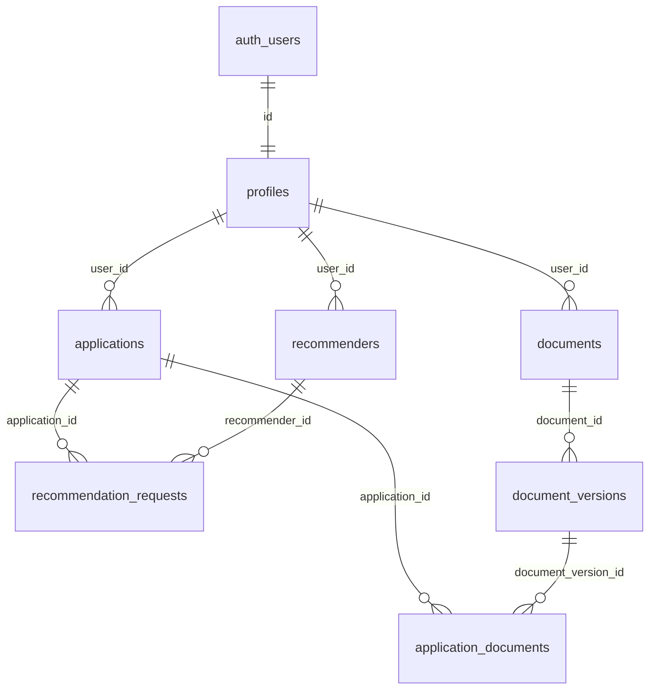

# AppTrail — Database Schema and API Documentation

COMP 426 final project. AppTrail is one place for students to track grad school and internship applications: deadlines, status, recommendation letters, and exactly which version of each essay or resume went to which application.

- **Stack:** Next.js (App Router) · Supabase (Postgres, Auth, Storage) · Drizzle ORM · tRPC + TanStack Query · Zod
- **Live app:** https://comp426-final-applicationagent.vercel.app
- **Source of truth:** tables in `server/db/schema.ts`, relations in `server/db/relations.ts`, API inputs in `server/models/inputs.ts`, API outputs in `server/models/responses.ts`, routers in `server/api/routers/`.

> **Status on 11/23.** The database below is created and live. Every procedure below exists with its final input and output validation. The procedure bodies are being implemented feature by feature; until then a procedure answers `NOT_IMPLEMENTED`.

---

## 1. Database schema

### 1.1 Diagram

<!-- TODO before submitting: Supabase dashboard → Database → Schema Visualizer → screenshot.
     Save it as docs/images/schema-visualizer.png and the image below will appear. -->


The same structure as a text diagram:



### 1.2 Conventions

- Names are `snake_case` in the database and `camelCase` in TypeScript (Drizzle maps them).
- Every id is a `uuid` generated by Postgres with `gen_random_uuid()`. The one exception is `profiles.id`, which is the Supabase Auth user's id.
- Every timestamp is `timestamptz` (stored in UTC, shown in the user's local time zone).
- Every table has `created_at`, default `now()`. Tables whose rows can be edited also have `updated_at`.
- Every foreign key is `ON DELETE CASCADE`: deleting a user removes everything they own.

### 1.3 Enums

| Enum                   | Values                                                                                                  |
| ---------------------- | ------------------------------------------------------------------------------------------------------- |
| `application_kind`     | `grad_school`, `internship`                                                                             |
| `application_status`   | `researching`, `preparing`, `submitted`, `interviewing`, `offer`, `waitlisted`, `rejected`, `withdrawn` |
| `application_priority` | `reach`, `target`, `safety`                                                                             |
| `letter_status`        | `planned`, `requested`, `confirmed`, `submitted`, `declined`                                            |
| `document_type`        | `sop`, `personal_statement`, `cv`, `resume`, `cover_letter`, `writing_sample`, `other`                  |

### 1.4 Tables

There are 7 tables in the `public` schema.

#### `profiles` — one row per user

Created automatically by a database trigger when Supabase Auth inserts a row into `auth.users` (see 1.6).

| Column         | Type          | Null | Default | Key / notes                                         |
| -------------- | ------------- | ---- | ------- | --------------------------------------------------- |
| `id`           | `uuid`        | no   | —       | **PK**. **FK** → `auth.users.id`, on delete cascade |
| `display_name` | `text`        | no   | —       | From the sign-up form                               |
| `created_at`   | `timestamptz` | no   | `now()` |                                                     |

#### `applications` — one grad school or internship application

| Column                  | Type                   | Null | Default             | Key / notes                                       |
| ----------------------- | ---------------------- | ---- | ------------------- | ------------------------------------------------- |
| `id`                    | `uuid`                 | no   | `gen_random_uuid()` | **PK**                                            |
| `user_id`               | `uuid`                 | no   | —                   | **FK** → `profiles.id`, on delete cascade         |
| `kind`                  | `application_kind`     | no   | —                   |                                                   |
| `organization`          | `text`                 | no   | —                   | School or company                                 |
| `position`              | `text`                 | no   | —                   | Program name or role title                        |
| `term`                  | `text`                 | yes  | —                   | For example "Fall 2027"                           |
| `status`                | `application_status`   | no   | `'researching'`     |                                                   |
| `priority`              | `application_priority` | yes  | —                   |                                                   |
| `deadline_at`           | `timestamptz`          | yes  | —                   | Null for rolling deadlines                        |
| `submitted_at`          | `timestamptz`          | yes  | —                   | Set the first time the status becomes `submitted` |
| `portal_url`            | `text`                 | yes  | —                   |                                                   |
| `location`              | `text`                 | yes  | —                   | Mostly for internships                            |
| `application_fee_cents` | `integer`              | yes  | —                   | Money is stored in cents                          |
| `notes`                 | `text`                 | yes  | —                   |                                                   |
| `created_at`            | `timestamptz`          | no   | `now()`             |                                                   |
| `updated_at`            | `timestamptz`          | no   | `now()`             | Set on every update                               |

- **Check** `applications_fee_non_negative`: `application_fee_cents >= 0`
- **Index** `applications_user_deadline_idx` on `(user_id, deadline_at)`

#### `recommenders` — a person who writes letters for the user

| Column          | Type          | Null | Default             | Key / notes                                           |
| --------------- | ------------- | ---- | ------------------- | ----------------------------------------------------- |
| `id`            | `uuid`        | no   | `gen_random_uuid()` | **PK**                                                |
| `user_id`       | `uuid`        | no   | —                   | **FK** → `profiles.id`, on delete cascade             |
| `name`          | `text`        | no   | —                   |                                                       |
| `email`         | `text`        | yes  | —                   |                                                       |
| `title`         | `text`        | yes  | —                   | For example "Associate Professor"                     |
| `organization`  | `text`        | yes  | —                   | For example "UNC Computer Science"                    |
| `relationship`  | `text`        | yes  | —                   | For example "Research advisor, 2 years"               |
| `notes`         | `text`        | yes  | —                   |                                                       |
| `share_token`   | `uuid`        | no   | `gen_random_uuid()` | **Unique**. The secret in the recommender portal link |
| `share_enabled` | `boolean`     | no   | `false`             | The portal link only works while this is true         |
| `created_at`    | `timestamptz` | no   | `now()`             |                                                       |
| `updated_at`    | `timestamptz` | no   | `now()`             | Set on every update                                   |

- **Unique** `recommenders_share_token_key` on `(share_token)`
- **Index** `recommenders_user_idx` on `(user_id)`

#### `recommendation_requests` — join table: applications ↔ recommenders

One row is one letter that one recommender owes for one application. It has its own id because a letter carries data (status, dates, notes) and is edited on its own.

| Column           | Type            | Null | Default             | Key / notes                                                                       |
| ---------------- | --------------- | ---- | ------------------- | --------------------------------------------------------------------------------- |
| `id`             | `uuid`          | no   | `gen_random_uuid()` | **PK**                                                                            |
| `application_id` | `uuid`          | no   | —                   | **FK** → `applications.id`, on delete cascade                                     |
| `recommender_id` | `uuid`          | no   | —                   | **FK** → `recommenders.id`, on delete cascade                                     |
| `status`         | `letter_status` | no   | `'planned'`         |                                                                                   |
| `requested_at`   | `timestamptz`   | yes  | —                   | Set the first time the status becomes `requested`                                 |
| `due_at`         | `timestamptz`   | yes  | —                   | Null means "use the application's deadline"                                       |
| `submitted_at`   | `timestamptz`   | yes  | —                   | Set when the status becomes `submitted`; cleared when it changes to anything else |
| `notes`          | `text`          | yes  | —                   |                                                                                   |
| `created_at`     | `timestamptz`   | no   | `now()`             |                                                                                   |
| `updated_at`     | `timestamptz`   | no   | `now()`             | Set on every update                                                               |

- **Unique** `recommendation_requests_application_recommender_unique` on `(application_id, recommender_id)`: a recommender writes at most one letter per application
- **Index** `recommendation_requests_recommender_idx` on `(recommender_id)`

#### `documents` — a logical document

For example "SOP – ML focus" or "Resume – SWE". The files themselves are rows of `document_versions`.

| Column       | Type            | Null | Default             | Key / notes                               |
| ------------ | --------------- | ---- | ------------------- | ----------------------------------------- |
| `id`         | `uuid`          | no   | `gen_random_uuid()` | **PK**                                    |
| `user_id`    | `uuid`          | no   | —                   | **FK** → `profiles.id`, on delete cascade |
| `title`      | `text`          | no   | —                   |                                           |
| `type`       | `document_type` | no   | —                   |                                           |
| `created_at` | `timestamptz`   | no   | `now()`             |                                           |
| `updated_at` | `timestamptz`   | no   | `now()`             | Set on every update                       |

- **Index** `documents_user_idx` on `(user_id)`

#### `document_versions` — one uploaded file

A version is never edited, so it has no `updated_at`.

| Column            | Type          | Null | Default             | Key / notes                                           |
| ----------------- | ------------- | ---- | ------------------- | ----------------------------------------------------- |
| `id`              | `uuid`        | no   | `gen_random_uuid()` | **PK**                                                |
| `document_id`     | `uuid`        | no   | —                   | **FK** → `documents.id`, on delete cascade            |
| `version_number`  | `integer`     | no   | —                   | Assigned by the server: current highest + 1           |
| `storage_path`    | `text`        | no   | —                   | Object path in the `documents` storage bucket         |
| `file_name`       | `text`        | no   | —                   | Original file name                                    |
| `file_size_bytes` | `integer`     | yes  | —                   |                                                       |
| `change_note`     | `text`        | yes  | —                   | For example "Shortened intro, added research section" |
| `created_at`      | `timestamptz` | no   | `now()`             |                                                       |

- **Unique** `document_versions_document_version_unique` on `(document_id, version_number)`

#### `application_documents` — join table: applications ↔ document_versions

One row records that one exact file version was attached to one application.

| Column                | Type          | Null | Default | Key / notes                                                         |
| --------------------- | ------------- | ---- | ------- | ------------------------------------------------------------------- |
| `application_id`      | `uuid`        | no   | —       | **PK** (part 1). **FK** → `applications.id`, on delete cascade      |
| `document_version_id` | `uuid`        | no   | —       | **PK** (part 2). **FK** → `document_versions.id`, on delete cascade |
| `attached_at`         | `timestamptz` | no   | `now()` |                                                                     |

- **Composite primary key** `(application_id, document_version_id)`
- **Index** `application_documents_version_idx` on `(document_version_id)`
- **Rule enforced by the API** (`applicationDocuments.attach`): at most one version of each document per application

### 1.5 Relationship summary

**Many-to-one** (the "many" side holds the foreign key):

| Many                | One         | Foreign key                     |
| ------------------- | ----------- | ------------------------------- |
| `applications`      | `profiles`  | `applications.user_id`          |
| `recommenders`      | `profiles`  | `recommenders.user_id`          |
| `documents`         | `profiles`  | `documents.user_id`             |
| `document_versions` | `documents` | `document_versions.document_id` |

**Many-to-many** (through a join table):

| Side A         | Side B              | Join table                | Meaning                                                                                                   |
| -------------- | ------------------- | ------------------------- | --------------------------------------------------------------------------------------------------------- |
| `applications` | `recommenders`      | `recommendation_requests` | One professor writes letters for many applications; one application needs letters from several professors |
| `applications` | `document_versions` | `application_documents`   | One essay version is sent to many applications; one application has several documents attached            |

**One-to-one:** `profiles.id` → `auth.users.id` (Supabase Auth's user table).

### 1.6 Trigger, Row Level Security and Storage

These are set up by the hand-written migration `supabase/migrations/20261123055800_auth_rls_storage/migration.sql`.

**Profile trigger.** `on_auth_user_created` runs `public.handle_new_user()` after every insert on `auth.users`. It inserts the matching `profiles` row, taking `display_name` from the sign-up metadata and falling back to the name part of the email.

**Where authorization happens.** The server reaches Postgres through Drizzle as the table owner, which bypasses Row Level Security. So the real authorization is in the tRPC procedures: every protected procedure filters by the signed-in user's id, and join rows are only created when _both_ sides belong to that user. A row that does not exist and a row owned by someone else both answer `NOT_FOUND`.

**Row Level Security** is still enabled on all 7 tables, because the publishable Supabase key ships to the browser and Supabase's auto-generated REST API must not expose the tables to it.

| Table                     | Policy                                       | Rule for the `authenticated` role                                              |
| ------------------------- | -------------------------------------------- | ------------------------------------------------------------------------------ |
| `profiles`                | `profiles_select_own`, `profiles_update_own` | `id = auth.uid()`                                                              |
| `applications`            | `applications_owner_all`                     | `user_id = auth.uid()`                                                         |
| `recommenders`            | `recommenders_owner_all`                     | `user_id = auth.uid()`                                                         |
| `documents`               | `documents_owner_all`                        | `user_id = auth.uid()`                                                         |
| `recommendation_requests` | `recommendation_requests_owner_all`          | The application belongs to the user; on write, the recommender must too        |
| `document_versions`       | `document_versions_owner_all`                | The parent document belongs to the user                                        |
| `application_documents`   | `application_documents_owner_all`            | The application belongs to the user; on write, the version's document must too |

There is no policy for the `anon` role, so signed-out requests see nothing.

**Storage.** Files live in the private bucket `documents`.

- Allowed types: PDF and DOCX. Maximum size: 10 MB. The bucket enforces both.
- Object path: `{userId}/{documentId}/{randomUUID}-{fileName}`
- Four policies on `storage.objects` (select, insert, update, delete): a signed-in user may only touch objects in the `documents` bucket whose first folder equals `auth.uid()`.
- Downloads use short-lived signed URLs created by `documents.downloadUrl`.

---

## 2. API

The backend is a tRPC API served at **`/api/trpc`**. The React frontend calls it asynchronously with tRPC's TanStack Query hooks (`api.applications.list.useQuery(...)`, `api.applications.create.useMutation()`).

### 2.1 Calling convention

|              |                                                                                                                   |
| ------------ | ----------------------------------------------------------------------------------------------------------------- |
| **Query**    | `GET /api/trpc/<router>.<procedure>?input=<URL-encoded JSON>`                                                     |
| **Mutation** | `POST /api/trpc/<router>.<procedure>` with a JSON body                                                            |
| **Envelope** | superjson: the input is `{ "json": <input> }` and a success is `{ "result": { "data": { "json": <output> } } }`   |
| **Dates**    | ISO 8601 strings in JSON, for example `"2026-12-15T04:59:00.000Z"`. superjson turns them back into `Date` objects |
| **Batching** | The client may combine several calls into one request (`?batch=1`)                                                |

The examples below show only the `<input>` and `<output>` parts.

**Access levels**

- **Auth** — the caller must be signed in. The session is a Supabase Auth cookie; the server verifies it and reads the user's id from it. Without a valid session the answer is `UNAUTHORIZED`. Every Auth procedure reads and writes only the signed-in user's own data.
- **Public** — no sign-in needed.

**Errors**

```json
{
  "error": {
    "json": {
      "message": "Application not found.",
      "code": -32004,
      "data": {
        "code": "NOT_FOUND",
        "httpStatus": 404,
        "path": "applications.byId",
        "zodError": null
      }
    }
  }
}
```

| Code           | HTTP | When                                                                                                                            |
| -------------- | ---- | ------------------------------------------------------------------------------------------------------------------------------- |
| `BAD_REQUEST`  | 400  | The input fails validation (`zodError` lists the fields), or a rule is broken, such as a storage path outside the user's folder |
| `UNAUTHORIZED` | 401  | An Auth procedure is called without a session                                                                                   |
| `NOT_FOUND`    | 404  | The row does not exist **or belongs to another user**                                                                           |
| `CONFLICT`     | 409  | The row already exists, such as assigning the same recommender twice                                                            |

### 2.2 Shared types

Optional input fields are marked `?`. For optional text, date and number fields, `null` (or an empty string for text) clears the value on update.

```ts
type Kind = "grad_school" | "internship";
type Status =
  | "researching"
  | "preparing"
  | "submitted"
  | "interviewing"
  | "offer"
  | "waitlisted"
  | "rejected"
  | "withdrawn";
type Priority = "reach" | "target" | "safety";
type LetterStatus =
  "planned" | "requested" | "confirmed" | "submitted" | "declined";
type DocType =
  | "sop"
  | "personal_statement"
  | "cv"
  | "resume"
  | "cover_letter"
  | "writing_sample"
  | "other";

type Application = {
  id: string;
  kind: Kind;
  organization: string;
  position: string;
  term: string | null;
  status: Status;
  priority: Priority | null;
  deadlineAt: string | null;
  submittedAt: string | null;
  portalUrl: string | null;
  location: string | null;
  applicationFeeCents: number | null;
  notes: string | null;
  createdAt: string;
  updatedAt: string;
};
type ApplicationSummary = Application & {
  letters: { submitted: number; total: number };
  documentCount: number;
};
type ApplicationDetail = Application & {
  letters: (RecommendationRequest & {
    recommender: {
      id: string;
      name: string;
      email: string | null;
      title: string | null;
    };
  })[];
  documents: {
    versionId: string;
    versionNumber: number;
    fileName: string;
    attachedAt: string;
    document: {
      id: string;
      title: string;
      type: DocType;
      latestVersionNumber: number;
    };
  }[];
};

type Recommender = {
  id: string;
  name: string;
  email: string | null;
  title: string | null;
  organization: string | null;
  relationship: string | null;
  notes: string | null;
  shareEnabled: boolean;
  createdAt: string;
  updatedAt: string;
};
type RecommenderWithStats = Recommender & {
  counts: Record<LetterStatus, number>;
  nextDueAt: string | null; // earliest letter still owed; falls back to the application's deadline
};
type RecommenderDetail = Recommender & {
  letters: (RecommendationRequest & {
    application: {
      id: string;
      organization: string;
      position: string;
      deadlineAt: string | null;
      status: Status;
    };
  })[];
};
type RecommendationRequest = {
  id: string;
  applicationId: string;
  recommenderId: string;
  status: LetterStatus;
  requestedAt: string | null;
  dueAt: string | null;
  submittedAt: string | null;
  notes: string | null;
};

// Named "Doc" rather than "Document" to avoid clashing with the browser's global Document type.
type Doc = {
  id: string;
  title: string;
  type: DocType;
  createdAt: string;
  updatedAt: string;
};
type DocVersion = {
  id: string;
  documentId: string;
  versionNumber: number;
  fileName: string;
  fileSizeBytes: number | null;
  changeNote: string | null;
  createdAt: string;
};
type DocSummary = Doc & {
  versionCount: number;
  latestVersion: {
    id: string;
    versionNumber: number;
    createdAt: string;
  } | null;
  applicationCount: number;
};
type DocDetail = Doc & {
  versions: (DocVersion & {
    applications: {
      id: string;
      organization: string;
      position: string;
      status: Status;
    }[];
  })[];
};

type DashboardSummary = {
  countsByStatus: Record<Status, number>;
  upcoming: {
    type: "application" | "letter";
    id: string;
    applicationId: string;
    title: string;
    dueAt: string;
  }[];
  outstandingLetters: {
    recommenderId: string;
    name: string;
    pending: number;
  }[];
  totalFeesCents: number;
};

type PortalView = {
  recommenderName: string;
  applicantName: string;
  letters: {
    id: string;
    organization: string;
    position: string;
    dueAt: string | null;
    status: LetterStatus;
  }[];
};
```

Three columns never leave the server: `user_id`, `recommenders.share_token` (only returned inside the share link) and `document_versions.storage_path`.

### 2.3 Procedure overview

29 procedures in 8 routers.

| Procedure                     | Kind     | Access     | Purpose                                     |
| ----------------------------- | -------- | ---------- | ------------------------------------------- |
| `profile.me`                  | query    | Auth       | The signed-in user                          |
| `profile.update`              | mutation | Auth       | Change the display name                     |
| `applications.list`           | query    | Auth       | List with filters, search and sort          |
| `applications.byId`           | query    | Auth       | One application with letters and documents  |
| `applications.create`         | mutation | Auth       | Create                                      |
| `applications.update`         | mutation | Auth       | Edit any field                              |
| `applications.updateStatus`   | mutation | Auth       | Change only the status                      |
| `applications.delete`         | mutation | Auth       | Delete                                      |
| `recommenders.list`           | query    | Auth       | List with letter counts and next due date   |
| `recommenders.byId`           | query    | Auth       | One recommender with their letters          |
| `recommenders.create`         | mutation | Auth       | Create                                      |
| `recommenders.update`         | mutation | Auth       | Edit any field                              |
| `recommenders.delete`         | mutation | Auth       | Delete                                      |
| `recommenders.setSharing`     | mutation | Auth       | Turn the portal link on or off              |
| `recommendations.assign`      | mutation | Auth       | Assign a recommender to an application      |
| `recommendations.update`      | mutation | Auth       | Edit a letter's status, due date or notes   |
| `recommendations.remove`      | mutation | Auth       | Remove a letter                             |
| `documents.list`              | query    | Auth       | List with version and usage counts          |
| `documents.byId`              | query    | Auth       | One document with its version history       |
| `documents.create`            | mutation | Auth       | Create (no versions yet)                    |
| `documents.update`            | mutation | Auth       | Rename or change the type                   |
| `documents.delete`            | mutation | Auth       | Delete, including the files                 |
| `documents.addVersion`        | mutation | Auth       | Record an uploaded file as the next version |
| `documents.downloadUrl`       | query    | Auth       | Signed download link for one version        |
| `applicationDocuments.attach` | mutation | Auth       | Attach a version to an application          |
| `applicationDocuments.detach` | mutation | Auth       | Detach a version                            |
| `dashboard.summary`           | query    | Auth       | Everything the dashboard shows              |
| `portal.byToken`              | query    | **Public** | A recommender's requested letters           |
| `portal.markSubmitted`        | mutation | **Public** | A recommender marks a letter as submitted   |

### 2.4 `profile` — Auth

#### `profile.me` · query · Auth

Input: none.

Output:

```json
{
  "id": "8d1f6c1e-2b7a-4c53-9a53-0f6f3c1b7a10",
  "displayName": "Alex Chen",
  "email": "alex.chen@example.com"
}
```

#### `profile.update` · mutation · Auth

`displayName`: 1–80 characters.

Input:

```json
{ "displayName": "Alex C." }
```

Output:

```json
{ "id": "8d1f6c1e-2b7a-4c53-9a53-0f6f3c1b7a10", "displayName": "Alex C." }
```

### 2.5 `applications` — Auth

#### `applications.list` · query · Auth

Input `{ kind?, statuses?: Status[], search?, sort?: "deadline" | "updated" | "organization" }`. Every field is optional and the whole input may be left out. `search` (at most 100 characters) matches the organization or the position.

Input:

```json
{
  "kind": "grad_school",
  "statuses": ["researching", "preparing"],
  "search": "carnegie",
  "sort": "deadline"
}
```

Output: `ApplicationSummary[]`

```json
[
  {
    "id": "5b0a4a7e-9d3c-4f0e-8a61-2f4c8f0d1e22",
    "kind": "grad_school",
    "organization": "Carnegie Mellon University",
    "position": "MS in Computer Science",
    "term": "Fall 2027",
    "status": "preparing",
    "priority": "reach",
    "deadlineAt": "2026-12-11T04:59:00.000Z",
    "submittedAt": null,
    "portalUrl": "https://applygrad.cs.cmu.edu",
    "location": null,
    "applicationFeeCents": 10000,
    "notes": "Needs 3 letters.",
    "createdAt": "2026-11-02T15:20:11.000Z",
    "updatedAt": "2026-11-20T01:05:42.000Z",
    "letters": { "submitted": 1, "total": 3 },
    "documentCount": 2
  }
]
```

#### `applications.byId` · query · Auth

`NOT_FOUND` if the application does not exist or belongs to another user.

Input:

```json
{ "id": "5b0a4a7e-9d3c-4f0e-8a61-2f4c8f0d1e22" }
```

Output: `ApplicationDetail`

```json
{
  "id": "5b0a4a7e-9d3c-4f0e-8a61-2f4c8f0d1e22",
  "kind": "grad_school",
  "organization": "Carnegie Mellon University",
  "position": "MS in Computer Science",
  "term": "Fall 2027",
  "status": "preparing",
  "priority": "reach",
  "deadlineAt": "2026-12-11T04:59:00.000Z",
  "submittedAt": null,
  "portalUrl": "https://applygrad.cs.cmu.edu",
  "location": null,
  "applicationFeeCents": 10000,
  "notes": "Needs 3 letters.",
  "createdAt": "2026-11-02T15:20:11.000Z",
  "updatedAt": "2026-11-20T01:05:42.000Z",
  "letters": [
    {
      "id": "c2a9d6f4-1b7e-4a38-b5d0-7e1f2a3b4c55",
      "applicationId": "5b0a4a7e-9d3c-4f0e-8a61-2f4c8f0d1e22",
      "recommenderId": "e7b3c1a0-4d2f-4e6a-9c8b-1a2b3c4d5e66",
      "status": "confirmed",
      "requestedAt": "2026-11-05T18:00:00.000Z",
      "dueAt": null,
      "submittedAt": null,
      "notes": "Sent CV and draft SOP.",
      "recommender": {
        "id": "e7b3c1a0-4d2f-4e6a-9c8b-1a2b3c4d5e66",
        "name": "Dr. Maya Patel",
        "email": "mpatel@cs.unc.edu",
        "title": "Associate Professor"
      }
    }
  ],
  "documents": [
    {
      "versionId": "a4f1e2d3-5c6b-4a79-8e0f-9d8c7b6a5f77",
      "versionNumber": 3,
      "fileName": "sop-ml-v3.pdf",
      "attachedAt": "2026-11-19T22:14:03.000Z",
      "document": {
        "id": "1f2e3d4c-5b6a-4789-90ab-cdef01234588",
        "title": "SOP – ML focus",
        "type": "sop",
        "latestVersionNumber": 4
      }
    }
  ]
}
```

#### `applications.create` · mutation · Auth

Input `{ kind, organization, position, term?, status?, priority?, deadlineAt?, portalUrl?, location?, applicationFeeCents?, notes? }`.

| Field                      | Rule                                                         |
| -------------------------- | ------------------------------------------------------------ |
| `organization`, `position` | Required, 1–200 characters                                   |
| `term`                     | At most 50 characters                                        |
| `status`                   | Defaults to `researching`                                    |
| `deadlineAt`               | ISO 8601 date and time                                       |
| `portalUrl`                | A valid `http://` or `https://` URL, at most 2000 characters |
| `location`                 | At most 200 characters                                       |
| `applicationFeeCents`      | Integer from 0 to 1,000,000                                  |
| `notes`                    | At most 5000 characters                                      |

Input:

```json
{
  "kind": "internship",
  "organization": "Stripe",
  "position": "Software Engineering Intern",
  "term": "Summer 2027",
  "priority": "target",
  "deadlineAt": "2027-01-16T04:59:00.000Z",
  "portalUrl": "https://stripe.com/jobs",
  "location": "Seattle, WA"
}
```

Output: `Application`

```json
{
  "id": "9c8b7a6f-5e4d-4c3b-a291-0f1e2d3c4b99",
  "kind": "internship",
  "organization": "Stripe",
  "position": "Software Engineering Intern",
  "term": "Summer 2027",
  "status": "researching",
  "priority": "target",
  "deadlineAt": "2027-01-16T04:59:00.000Z",
  "submittedAt": null,
  "portalUrl": "https://stripe.com/jobs",
  "location": "Seattle, WA",
  "applicationFeeCents": null,
  "notes": null,
  "createdAt": "2026-11-23T16:02:10.000Z",
  "updatedAt": "2026-11-23T16:02:10.000Z"
}
```

#### `applications.update` · mutation · Auth

Input `{ id }` plus any `create` field, all optional. Only the fields that are sent change. `NOT_FOUND` if the application is not the user's.

Input:

```json
{
  "id": "9c8b7a6f-5e4d-4c3b-a291-0f1e2d3c4b99",
  "deadlineAt": "2027-01-23T04:59:00.000Z",
  "notes": "Deadline extended by a week."
}
```

Output: `Application` (same shape as `applications.create`, with the new values).

#### `applications.updateStatus` · mutation · Auth

Used by the inline status select and the board view. Sets `submittedAt` the first time the status becomes `submitted`.

Input:

```json
{ "id": "5b0a4a7e-9d3c-4f0e-8a61-2f4c8f0d1e22", "status": "submitted" }
```

Output: `Application`

```json
{
  "id": "5b0a4a7e-9d3c-4f0e-8a61-2f4c8f0d1e22",
  "kind": "grad_school",
  "organization": "Carnegie Mellon University",
  "position": "MS in Computer Science",
  "term": "Fall 2027",
  "status": "submitted",
  "priority": "reach",
  "deadlineAt": "2026-12-11T04:59:00.000Z",
  "submittedAt": "2026-12-08T21:30:44.000Z",
  "portalUrl": "https://applygrad.cs.cmu.edu",
  "location": null,
  "applicationFeeCents": 10000,
  "notes": "Needs 3 letters.",
  "createdAt": "2026-11-02T15:20:11.000Z",
  "updatedAt": "2026-12-08T21:30:44.000Z"
}
```

#### `applications.delete` · mutation · Auth

Also deletes the application's letters and attachments (cascade). The documents themselves are kept.

Input:

```json
{ "id": "9c8b7a6f-5e4d-4c3b-a291-0f1e2d3c4b99" }
```

Output:

```json
{ "id": "9c8b7a6f-5e4d-4c3b-a291-0f1e2d3c4b99" }
```

### 2.6 `recommenders` — Auth

#### `recommenders.list` · query · Auth

Input: none.

Output: `RecommenderWithStats[]`

```json
[
  {
    "id": "e7b3c1a0-4d2f-4e6a-9c8b-1a2b3c4d5e66",
    "name": "Dr. Maya Patel",
    "email": "mpatel@cs.unc.edu",
    "title": "Associate Professor",
    "organization": "UNC Computer Science",
    "relationship": "Research advisor, 2 years",
    "notes": null,
    "shareEnabled": false,
    "createdAt": "2026-11-01T14:00:00.000Z",
    "updatedAt": "2026-11-01T14:00:00.000Z",
    "counts": {
      "planned": 1,
      "requested": 2,
      "confirmed": 1,
      "submitted": 2,
      "declined": 0
    },
    "nextDueAt": "2026-12-02T04:59:00.000Z"
  }
]
```

#### `recommenders.byId` · query · Auth

Input:

```json
{ "id": "e7b3c1a0-4d2f-4e6a-9c8b-1a2b3c4d5e66" }
```

Output: `RecommenderDetail`

```json
{
  "id": "e7b3c1a0-4d2f-4e6a-9c8b-1a2b3c4d5e66",
  "name": "Dr. Maya Patel",
  "email": "mpatel@cs.unc.edu",
  "title": "Associate Professor",
  "organization": "UNC Computer Science",
  "relationship": "Research advisor, 2 years",
  "notes": null,
  "shareEnabled": false,
  "createdAt": "2026-11-01T14:00:00.000Z",
  "updatedAt": "2026-11-01T14:00:00.000Z",
  "letters": [
    {
      "id": "c2a9d6f4-1b7e-4a38-b5d0-7e1f2a3b4c55",
      "applicationId": "5b0a4a7e-9d3c-4f0e-8a61-2f4c8f0d1e22",
      "recommenderId": "e7b3c1a0-4d2f-4e6a-9c8b-1a2b3c4d5e66",
      "status": "confirmed",
      "requestedAt": "2026-11-05T18:00:00.000Z",
      "dueAt": null,
      "submittedAt": null,
      "notes": "Sent CV and draft SOP.",
      "application": {
        "id": "5b0a4a7e-9d3c-4f0e-8a61-2f4c8f0d1e22",
        "organization": "Carnegie Mellon University",
        "position": "MS in Computer Science",
        "deadlineAt": "2026-12-11T04:59:00.000Z",
        "status": "preparing"
      }
    }
  ]
}
```

#### `recommenders.create` · mutation · Auth

Input `{ name, email?, title?, organization?, relationship?, notes? }`. `name`: 1–200 characters. `email`: a valid address. `title`, `organization`, `relationship`: at most 200 characters. `notes`: at most 5000.

Input:

```json
{
  "name": "Dr. Samuel Ortiz",
  "email": "sortiz@cs.unc.edu",
  "title": "Professor",
  "organization": "UNC Computer Science",
  "relationship": "COMP 550 instructor"
}
```

Output: `Recommender`

```json
{
  "id": "0a1b2c3d-4e5f-4a6b-8c7d-9e0f1a2b3caa",
  "name": "Dr. Samuel Ortiz",
  "email": "sortiz@cs.unc.edu",
  "title": "Professor",
  "organization": "UNC Computer Science",
  "relationship": "COMP 550 instructor",
  "notes": null,
  "shareEnabled": false,
  "createdAt": "2026-11-23T16:10:00.000Z",
  "updatedAt": "2026-11-23T16:10:00.000Z"
}
```

#### `recommenders.update` · mutation · Auth

Input `{ id }` plus any `create` field, all optional.

Input:

```json
{
  "id": "0a1b2c3d-4e5f-4a6b-8c7d-9e0f1a2b3caa",
  "notes": "Prefers two weeks of notice."
}
```

Output: `Recommender` (same shape as `recommenders.create`, with the new values).

#### `recommenders.delete` · mutation · Auth

Also deletes that recommender's letters (cascade).

Input:

```json
{ "id": "0a1b2c3d-4e5f-4a6b-8c7d-9e0f1a2b3caa" }
```

Output:

```json
{ "id": "0a1b2c3d-4e5f-4a6b-8c7d-9e0f1a2b3caa" }
```

#### `recommenders.setSharing` · mutation · Auth

Turns the recommender portal link on or off. `regenerateToken: true` replaces the secret, so an old link stops working.

Input:

```json
{ "id": "e7b3c1a0-4d2f-4e6a-9c8b-1a2b3c4d5e66", "enabled": true }
```

Output:

```json
{
  "shareEnabled": true,
  "shareUrl": "https://comp426-final-applicationagent.vercel.app/r/6f5e4d3c-2b1a-4098-8f7e-6d5c4b3a2fbb"
}
```

When sharing is off, `shareUrl` is `null`.

### 2.7 `recommendations` — Auth (the applications ↔ recommenders join)

#### `recommendations.assign` · mutation · Auth

Creates a letter. Both the application and the recommender must belong to the user, otherwise `NOT_FOUND`. `CONFLICT` if that recommender is already assigned to that application.

Input:

```json
{
  "applicationId": "5b0a4a7e-9d3c-4f0e-8a61-2f4c8f0d1e22",
  "recommenderId": "0a1b2c3d-4e5f-4a6b-8c7d-9e0f1a2b3caa",
  "dueAt": "2026-12-04T04:59:00.000Z"
}
```

Output: `RecommendationRequest`

```json
{
  "id": "d4c3b2a1-0f9e-4d8c-b7a6-5f4e3d2c1bcc",
  "applicationId": "5b0a4a7e-9d3c-4f0e-8a61-2f4c8f0d1e22",
  "recommenderId": "0a1b2c3d-4e5f-4a6b-8c7d-9e0f1a2b3caa",
  "status": "planned",
  "requestedAt": null,
  "dueAt": "2026-12-04T04:59:00.000Z",
  "submittedAt": null,
  "notes": null
}
```

#### `recommendations.update` · mutation · Auth

Input `{ id, status?, dueAt?, notes? }`. Sets `requestedAt` the first time the status becomes `requested`, and `submittedAt` when it becomes `submitted`. Changing the status away from `submitted` clears `submittedAt`, so it is set exactly while the letter is submitted.

Input:

```json
{
  "id": "d4c3b2a1-0f9e-4d8c-b7a6-5f4e3d2c1bcc",
  "status": "requested",
  "notes": "Emailed on 11/23."
}
```

Output: `RecommendationRequest`

```json
{
  "id": "d4c3b2a1-0f9e-4d8c-b7a6-5f4e3d2c1bcc",
  "applicationId": "5b0a4a7e-9d3c-4f0e-8a61-2f4c8f0d1e22",
  "recommenderId": "0a1b2c3d-4e5f-4a6b-8c7d-9e0f1a2b3caa",
  "status": "requested",
  "requestedAt": "2026-11-23T16:20:31.000Z",
  "dueAt": "2026-12-04T04:59:00.000Z",
  "submittedAt": null,
  "notes": "Emailed on 11/23."
}
```

#### `recommendations.remove` · mutation · Auth

Input:

```json
{ "id": "d4c3b2a1-0f9e-4d8c-b7a6-5f4e3d2c1bcc" }
```

Output:

```json
{ "id": "d4c3b2a1-0f9e-4d8c-b7a6-5f4e3d2c1bcc" }
```

### 2.8 `documents` — Auth

#### `documents.list` · query · Auth

Input `{ type? }`; the whole input may be left out.

Input:

```json
{ "type": "sop" }
```

Output: `DocSummary[]`

```json
[
  {
    "id": "1f2e3d4c-5b6a-4789-90ab-cdef01234588",
    "title": "SOP – ML focus",
    "type": "sop",
    "createdAt": "2026-10-20T13:00:00.000Z",
    "updatedAt": "2026-11-21T02:11:09.000Z",
    "versionCount": 4,
    "latestVersion": {
      "id": "b8a7c6d5-e4f3-4a2b-9c1d-0e9f8a7b6cdd",
      "versionNumber": 4,
      "createdAt": "2026-11-21T02:11:09.000Z"
    },
    "applicationCount": 5
  }
]
```

A document with no versions yet has `"versionCount": 0` and `"latestVersion": null`.

#### `documents.byId` · query · Auth

Input:

```json
{ "id": "1f2e3d4c-5b6a-4789-90ab-cdef01234588" }
```

Output: `DocDetail` (versions newest first)

```json
{
  "id": "1f2e3d4c-5b6a-4789-90ab-cdef01234588",
  "title": "SOP – ML focus",
  "type": "sop",
  "createdAt": "2026-10-20T13:00:00.000Z",
  "updatedAt": "2026-11-21T02:11:09.000Z",
  "versions": [
    {
      "id": "b8a7c6d5-e4f3-4a2b-9c1d-0e9f8a7b6cdd",
      "documentId": "1f2e3d4c-5b6a-4789-90ab-cdef01234588",
      "versionNumber": 4,
      "fileName": "sop-ml-v4.pdf",
      "fileSizeBytes": 184320,
      "changeNote": "Shortened intro, added research section",
      "createdAt": "2026-11-21T02:11:09.000Z",
      "applications": []
    },
    {
      "id": "a4f1e2d3-5c6b-4a79-8e0f-9d8c7b6a5f77",
      "documentId": "1f2e3d4c-5b6a-4789-90ab-cdef01234588",
      "versionNumber": 3,
      "fileName": "sop-ml-v3.pdf",
      "fileSizeBytes": 179200,
      "changeNote": "Tailored the last paragraph",
      "createdAt": "2026-11-12T19:40:00.000Z",
      "applications": [
        {
          "id": "5b0a4a7e-9d3c-4f0e-8a61-2f4c8f0d1e22",
          "organization": "Carnegie Mellon University",
          "position": "MS in Computer Science",
          "status": "preparing"
        }
      ]
    }
  ]
}
```

#### `documents.create` · mutation · Auth

`title`: 1–200 characters.

Input:

```json
{ "title": "Resume – SWE", "type": "resume" }
```

Output: `Doc`

```json
{
  "id": "7e6d5c4b-3a29-4180-8f7e-6d5c4b3a29ee",
  "title": "Resume – SWE",
  "type": "resume",
  "createdAt": "2026-11-23T16:30:00.000Z",
  "updatedAt": "2026-11-23T16:30:00.000Z"
}
```

#### `documents.update` · mutation · Auth

Input `{ id, title?, type? }`.

Input:

```json
{
  "id": "7e6d5c4b-3a29-4180-8f7e-6d5c4b3a29ee",
  "title": "Resume – SWE (1 page)"
}
```

Output: `Doc` (same shape as `documents.create`, with the new values).

#### `documents.delete` · mutation · Auth

Deletes the document, its versions and its attachments (cascade), and also removes the document's files from Storage.

Input:

```json
{ "id": "7e6d5c4b-3a29-4180-8f7e-6d5c4b3a29ee" }
```

Output:

```json
{ "id": "7e6d5c4b-3a29-4180-8f7e-6d5c4b3a29ee" }
```

#### `documents.addVersion` · mutation · Auth

Uploading is two steps. First the browser uploads the file straight to the `documents` bucket with the user's session. Then it calls this procedure to record the file. The server assigns `versionNumber` (current highest + 1).

| Field           | Rule                                                 |
| --------------- | ---------------------------------------------------- |
| `storagePath`   | Must start with `{userId}/`, otherwise `BAD_REQUEST` |
| `fileName`      | 1–255 characters                                     |
| `fileSizeBytes` | Integer from 1 to 10,485,760 (10 MB)                 |
| `changeNote`    | Optional, at most 500 characters                     |

Input:

```json
{
  "documentId": "7e6d5c4b-3a29-4180-8f7e-6d5c4b3a29ee",
  "storagePath": "8d1f6c1e-2b7a-4c53-9a53-0f6f3c1b7a10/7e6d5c4b-3a29-4180-8f7e-6d5c4b3a29ee/3c2b1a09-f8e7-4d6c-b5a4-93827160f5ff-resume.pdf",
  "fileName": "resume.pdf",
  "fileSizeBytes": 96512,
  "changeNote": "Added the summer research project"
}
```

Output: `DocVersion`

```json
{
  "id": "f0e1d2c3-b4a5-4697-8879-6a5b4c3d2e11",
  "documentId": "7e6d5c4b-3a29-4180-8f7e-6d5c4b3a29ee",
  "versionNumber": 1,
  "fileName": "resume.pdf",
  "fileSizeBytes": 96512,
  "changeNote": "Added the summer research project",
  "createdAt": "2026-11-23T16:35:12.000Z"
}
```

#### `documents.downloadUrl` · query · Auth

Returns a signed URL that expires. `NOT_FOUND` if the version is not the user's.

Input:

```json
{ "versionId": "f0e1d2c3-b4a5-4697-8879-6a5b4c3d2e11" }
```

Output:

```json
{
  "url": "https://abcdefghijklmnopqrst.supabase.co/storage/v1/object/sign/documents/8d1f6c1e-2b7a-4c53-9a53-0f6f3c1b7a10/7e6d5c4b-3a29-4180-8f7e-6d5c4b3a29ee/3c2b1a09-f8e7-4d6c-b5a4-93827160f5ff-resume.pdf?token=eyJhbGciOiJIUzI1NiJ9.example",
  "expiresInSeconds": 60
}
```

### 2.9 `applicationDocuments` — Auth (the applications ↔ document_versions join)

#### `applicationDocuments.attach` · mutation · Auth

Both the application and the document version must belong to the user, otherwise `NOT_FOUND`. If another version of the same document is already attached to that application, it is replaced, so an application never holds two versions of one document.

Input:

```json
{
  "applicationId": "5b0a4a7e-9d3c-4f0e-8a61-2f4c8f0d1e22",
  "documentVersionId": "b8a7c6d5-e4f3-4a2b-9c1d-0e9f8a7b6cdd"
}
```

Output:

```json
{
  "applicationId": "5b0a4a7e-9d3c-4f0e-8a61-2f4c8f0d1e22",
  "documentVersionId": "b8a7c6d5-e4f3-4a2b-9c1d-0e9f8a7b6cdd",
  "attachedAt": "2026-11-23T16:40:00.000Z"
}
```

#### `applicationDocuments.detach` · mutation · Auth

Input:

```json
{
  "applicationId": "5b0a4a7e-9d3c-4f0e-8a61-2f4c8f0d1e22",
  "documentVersionId": "b8a7c6d5-e4f3-4a2b-9c1d-0e9f8a7b6cdd"
}
```

Output:

```json
{
  "applicationId": "5b0a4a7e-9d3c-4f0e-8a61-2f4c8f0d1e22",
  "documentVersionId": "b8a7c6d5-e4f3-4a2b-9c1d-0e9f8a7b6cdd"
}
```

### 2.10 `dashboard` — Auth

#### `dashboard.summary` · query · Auth

One request for everything on the dashboard.

- `upcoming`: overdue items plus the next 30 days, sorted by due date. It contains applications in `researching` or `preparing` that have a deadline, and letters that are not `submitted` or `declined` (a letter without its own due date uses the application's deadline).
- `outstandingLetters`: letters still owed, per recommender.
- `totalFeesCents`: the fees of the applications that have a `submittedAt`.

Input: none.

Output: `DashboardSummary`

```json
{
  "countsByStatus": {
    "researching": 3,
    "preparing": 4,
    "submitted": 2,
    "interviewing": 1,
    "offer": 1,
    "waitlisted": 0,
    "rejected": 1,
    "withdrawn": 0
  },
  "upcoming": [
    {
      "type": "letter",
      "id": "c2a9d6f4-1b7e-4a38-b5d0-7e1f2a3b4c55",
      "applicationId": "5b0a4a7e-9d3c-4f0e-8a61-2f4c8f0d1e22",
      "title": "Letter from Dr. Maya Patel — Carnegie Mellon University",
      "dueAt": "2026-12-02T04:59:00.000Z"
    },
    {
      "type": "application",
      "id": "5b0a4a7e-9d3c-4f0e-8a61-2f4c8f0d1e22",
      "applicationId": "5b0a4a7e-9d3c-4f0e-8a61-2f4c8f0d1e22",
      "title": "Carnegie Mellon University — MS in Computer Science",
      "dueAt": "2026-12-11T04:59:00.000Z"
    }
  ],
  "outstandingLetters": [
    {
      "recommenderId": "e7b3c1a0-4d2f-4e6a-9c8b-1a2b3c4d5e66",
      "name": "Dr. Maya Patel",
      "pending": 4
    }
  ],
  "totalFeesCents": 21500
}
```

### 2.11 `portal` — Public (for recommenders, no login)

A recommender has no account. The unguessable token in their link (`/r/<token>`) grants access, and only while the applicant has sharing turned on for that recommender.

#### `portal.byToken` · query · **Public**

`NOT_FOUND` if the token is unknown or sharing is off. Returns only letters in `requested`, `confirmed` or `submitted`.

Input:

```json
{ "token": "6f5e4d3c-2b1a-4098-8f7e-6d5c4b3a2fbb" }
```

Output: `PortalView`

```json
{
  "recommenderName": "Dr. Maya Patel",
  "applicantName": "Alex Chen",
  "letters": [
    {
      "id": "c2a9d6f4-1b7e-4a38-b5d0-7e1f2a3b4c55",
      "organization": "Carnegie Mellon University",
      "position": "MS in Computer Science",
      "dueAt": "2026-12-11T04:59:00.000Z",
      "status": "confirmed"
    }
  ]
}
```

#### `portal.markSubmitted` · mutation · **Public**

Marks one letter as submitted. The letter must belong to the recommender that the token identifies, otherwise `NOT_FOUND`.

Input:

```json
{
  "token": "6f5e4d3c-2b1a-4098-8f7e-6d5c4b3a2fbb",
  "requestId": "c2a9d6f4-1b7e-4a38-b5d0-7e1f2a3b4c55"
}
```

Output:

```json
{
  "id": "c2a9d6f4-1b7e-4a38-b5d0-7e1f2a3b4c55",
  "status": "submitted",
  "submittedAt": "2026-12-01T15:02:47.000Z"
}
```
